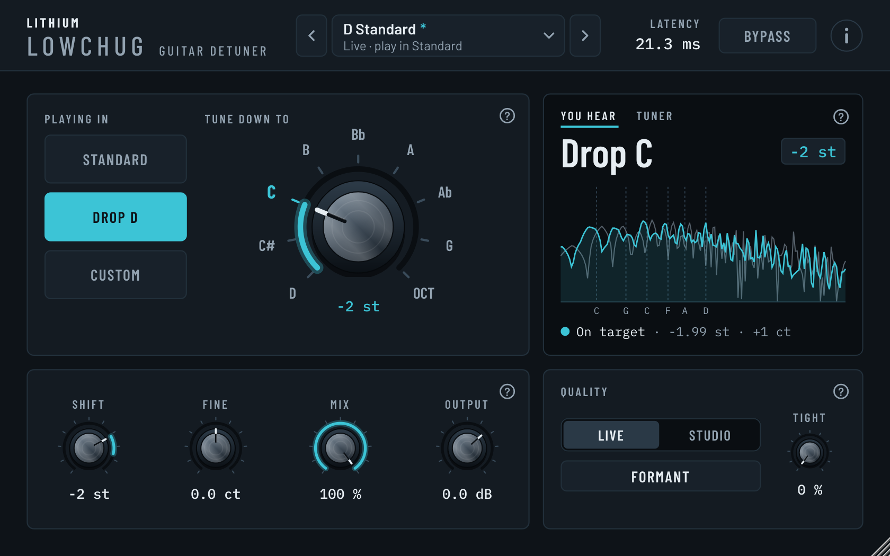
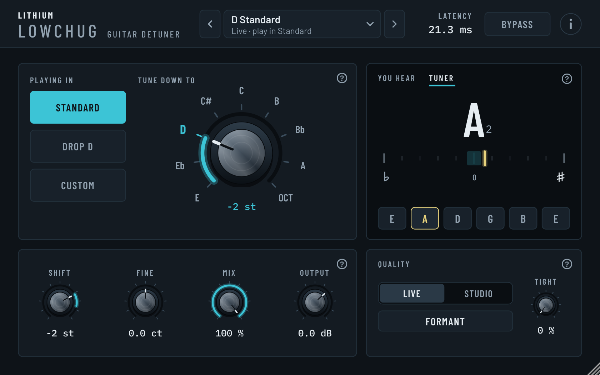

<p align="center"></p>

<h1 align="center">Lithium LowChug</h1>

**A free, open-source guitar detuner.** Play in standard (or Drop D) and hear your guitar tuned lower: E♭ standard, D standard, Drop C, B standard, an octave down. Chords included, and tight enough to play through live.



VST3, LV2, AU and a standalone app · Linux, Windows and macOS · Version 0.5.0 · Free software, [GNU AGPLv3](LICENSE)

By Isaac Joseph ([Calamity Audio](https://github.com/thecalamityjoe87)). Part of the Lithium family, with Lithium Drums and Lithium Studio.

## What it is

Lithium LowChug is a polyphonic pitch shifter for guitar. It shifts the whole guitar at once, chords and all, so you can play a song in a lower tuning without retuning your guitar or reaching for a second one. Plug in, pick the tuning you want to hear, and play.

It runs in your DAW as a plugin, on a guitar track before your amp sim, or on its own as a standalone app with your guitar plugged into your audio interface.

It's early software. Everything below works and has been checked in a host, but expect rough edges, and expect things to change before 1.0.

## What it can do

### Pick your tuning

Tell LowChug how your guitar is tuned with the Playing in buttons (Standard, Drop D or Custom), then turn the "Tune down to" dial to the tuning you want to hear. The dial's notches are the tunings reachable from yours: from standard, E♭ standard down to A standard and an octave down; from Drop D, Drop C# down to Drop G and an octave down. Custom sets the shift by hand with the Shift and Fine knobs. Each card has a "?" that explains it.

### Live and Studio

Two modes, switched with the Live | Studio buttons or the presets. Live has 1024 samples (21.3 ms) of latency at 48 kHz, for playing through; Studio has 2304 samples (48.0 ms) and the cleanest low end, for recording and mixing. Hosts are told the new latency when you switch, and the sound crossfades once the other engine has warmed up (about a quarter of a second).

### Shape the sound

Formant keeps the guitar's tone in place as the pitch drops (off is the classic pitch pedal sound). Tight is a gentle low cut that follows the shift, so the lowest tunings don't turn to mud. Mix blends in the dry guitar, and Output sets the level.

### Tune up and check what you hear



The right card has two tabs. TUNER tunes the guitar itself (before the shift) to the tuning you play in. YOU HEAR shows the input and output spectra with the open strings of the tuning you hear marked, and the shift actually measured between input and output (it compares the two spectra on a log-frequency axis, so it works on chords), with how many cents it is from what the controls ask for.

### Presets

The header's preset box holds the factory presets: Eb, D, C#, C and B Standard, Drop C, B and A, and Octave Down, each in a Live and a Studio version. Hosts list the same 18 as programs. The name gets a "*" once you change a setting it covers. The presets are built into the plugin, so there's nothing to download.

## Install

Download the installer for your system from the [Releases](../../releases) page:

- **Linux:** unpack the `.tar.gz` and double-click "Install Lithium LowChug". It installs into your home folder (no password) and adds Lithium LowChug to your app menu. Run it again to update or remove it.
- **Windows:** run `LithiumLowChug-<version>-windows-setup.exe`.
- **macOS:** open `LithiumLowChug-<version>-macos.pkg` (Apple silicon and Intel, macOS 11 or later).

Each installer lets you pick the standalone app and the plugin formats. The installers aren't signed yet, so Windows may show a SmartScreen warning ("More info", then "Run anyway") and macOS may refuse to open it as coming from an unidentified developer (allow it under System Settings › Privacy & Security, Open Anyway).

Then open Lithium LowChug: in your DAW, rescan plugins and add it to a guitar track; or open the standalone app from your app menu.

## Using it

In a DAW, put LowChug first on the guitar track, before the amp sim, so the amp sees the lower tuning. It reports its latency to the host, so the track stays in time; Bypass keeps that delay, so switching it never shifts the guitar in time.

The standalone app takes a mono input and plays the result on both outputs. Choose your guitar's input under Options › Audio/MIDI Settings. On Linux it can open your interface directly through ALSA, or through JACK (PipeWire's `pw-jack` works). Its settings are kept in `~/.config/Lithium LowChug.settings` on Linux.

## License and credits

Lithium LowChug is Copyright (C) 2026 Isaac Joseph. It is free software: you can redistribute it and change it under the terms of the GNU Affero General Public License, version 3, in [LICENSE](LICENSE). It comes with no warranty.

The packages also carry `THIRD-PARTY-NOTICES.txt`, the copyright notices and licenses of the code built into the program (JUCE and the libraries it compiles in, the VST3 SDK, LV2, the AudioUnitSDK on macOS, the Signalsmith libraries) and of the fonts. `scripts/third-party-notices.py` writes it from the license files of the downloaded dependencies, so it follows their versions.

JUCE is dual-licensed under the AGPLv3 and a commercial license; distributing LowChug binaries needs one or the other. Signalsmith Stretch and Signalsmith Linear are MIT licensed. The fonts (Barlow, Barlow Condensed, IBM Plex Mono) are under the SIL Open Font License; see `assets/fonts/`.

## Development

How it works inside is described in the docs: the engine choice and the quality features in [docs/engine-evaluation.md](docs/engine-evaluation.md), validation, CPU profiling and the tests in [docs/hardening.md](docs/hardening.md), and the manual host checks in [docs/host-checklist.md](docs/host-checklist.md).

### Status

| Milestone | State |
|---|---|
| 1. Skeleton and engine evaluation | done: see [docs/engine-evaluation.md](docs/engine-evaluation.md) |
| 2. Core DSP | done |
| 3. Quality features (modes, formants, transients, tight) | done: see the milestone 3 section of the engine evaluation |
| 4. UI and presets | done (ahead of 3, so the plugin could be play-tested): UI, factory presets, tuner |
| 5. Hardening (pluginval, hosts, profiling) | done: see [docs/hardening.md](docs/hardening.md); host checks passed in Lithium Studio ([docs/host-checklist.md](docs/host-checklist.md)) |

### Building

You need CMake 3.25 or newer, a C++20 compiler and Ninja. On Linux, install JUCE's dependencies first (Debian/Ubuntu package names):

```bash
sudo apt install build-essential cmake ninja-build libasound2-dev libjack-jackd2-dev \
  libfreetype-dev libfontconfig1-dev libx11-dev libxcomposite-dev libxcursor-dev \
  libxext-dev libxinerama-dev libxrandr-dev libxrender-dev libxi-dev libgl-dev
```

JUCE and the Signalsmith libraries are fetched automatically at configure time. Then:

```bash
scripts/build.sh release      # or: debug
```

The script just runs `cmake --preset <name>` and `cmake --build --preset <name>` (see `CMakePresets.json`). Output lands in `build/<preset>/`, and the fetched dependencies in `build/_deps/`, shared by every preset. The build runs one compile per 2 GB of RAM, since JUCE's sources take a lot of memory to compile. On Windows, run the same presets from a Visual Studio developer prompt (`scripts/build.ps1`). On macOS, install Ninja with Homebrew.

Plain CMake works too (`cmake -S . -B build/release -G Ninja -DCMAKE_BUILD_TYPE=Release`, then `cmake --build build/release`); a folder configured that way keeps its dependencies inside it. If you later switch such a folder to the presets, delete its `vst3_helpers` folder once: JUCE's VST3 manifest helper caches the old JUCE path there.

Plugins end up in `build/release/src/plugin/LithiumLowChug_artefacts/Release/`, and the standalone app is `Standalone/Lithium LowChug` in there. Configuring with `-DLOWCHUG_COPY_PLUGINS=ON` also copies the plugins into your user plugin folders (on Linux `~/.vst3/Lithium LowChug.vst3` and `~/.lv2/Lithium LowChug.lv2`).

| Option | Default | Builds |
|---|---|---|
| `LOWCHUG_BUILD_PLUGIN` | ON | the JUCE plugin (and, on Linux, the installer) |
| `LOWCHUG_BUILD_TOOLS` | ON | the engine A/B harness, the CPU profiler and the icon generator |
| `LOWCHUG_BUILD_TESTS` | ON | the unit tests |

For quick DSP-only work, skip JUCE entirely:

```bash
cmake -S . -B build/eval -G Ninja -DLOWCHUG_BUILD_PLUGIN=OFF
```

### Packaging and installers

Each system gets a graphical installer, the same as Lithium Drums', that shows the two ways to use Lithium LowChug (as a plugin in a DAW, or as a standalone app) and lets the user pick the standalone app, VST3 and LV2 (and AU on macOS):

| System | Installer | Built by | Installs to |
|---|---|---|---|
| Linux | `LithiumLowChug-<version>-linux-x86_64.tar.gz`: unpack, double-click "Install Lithium LowChug" (its own window, `tools/installer/`) | `scripts/package.sh` | the home folder, no password: `~/.vst3`, `~/.lv2`, `~/.local/lib/lithium-lowchug` plus an app-menu entry |
| Windows | `LithiumLowChug-<version>-windows-setup.exe` (Inno Setup, `packaging/windows/LithiumLowChug.iss`) and a `.zip` | `scripts/package.ps1` (needs Inno Setup 6 or 7) | `Program Files`, `Common Files\VST3`, `Common Files\LV2` |
| macOS | `LithiumLowChug-<version>-macos.pkg` (the Installer app, `packaging/macos/`) and a `.zip` | `scripts/package.sh` | `/Applications`, `/Library/Audio/Plug-Ins/{VST3,LV2,Components}` |

`scripts/package.sh release dist` builds the release preset and writes the package to `dist/`. Running the Linux installer again offers Update and Remove; Remove deletes only what it installed (it keeps a list in `~/.local/lib/lithium-lowchug/install.json`). It also runs from a terminal: `./"Install Lithium LowChug" --install [standalone,vst3,lv2]` (or `--remove`). `LITHIUM_INSTALLER_PAYLOAD=<folder>` makes it install from another payload folder, for testing.

`.github/workflows/release.yml` builds all three on GitHub's machines: run it from the Actions tab (Release › Run workflow) to get the packages as the run's artifacts, or push a version tag (`v0.5.0`) to also get a draft release with them attached. The Linux build runs on Ubuntu 22.04, so it works with older glibc versions; the macOS build is universal (arm64 and x86_64, macOS 11 or later). Unsigned, Windows shows a SmartScreen warning and macOS an "unidentified developer" one; the workflow's comments list the secrets that turn on macOS signing and notarization (an Apple Developer account).

The icon and the installers' artwork (`assets/icon/`) are drawn from the logo code (`src/ui/Logo.cpp`: a guitar pick with a flat sign cut out of it); after changing it, run `scripts/make-icons.sh` (needs ImageMagick 7).

### Tests

```
ctest --test-dir build/release --output-on-failure
build/release/tests/lowchug-dsp-tests                  # the DSP core, no JUCE: pitch, latency, clicks, quality
build/release/tests/lowchug-dsp-checked-tests          # the DSP code with bounds checks on, under hostile input
build/release/tests/lowchug-plugin-tests               # the JUCE processor, presets, state, threading and editor
build/release/tests/lowchug-installer-tests_artefacts/Release/lowchug-installer-tests   # Linux installer: install, update, remove in a scratch home
LOWCHUG_SNAPSHOT_DIR=/tmp build/release/tests/lowchug-plugin-tests   # also saves PNG snapshots of the editor
build/release/tools/profile/lowchug-profile            # average CPU and worst blocks
build/release/tools/profile/lowchug-profile-stages     # where the time goes
```

[pluginval](https://github.com/Tracktion/pluginval) passes at strictness 10 (the highest) for the VST3 and the LV2, and Steinberg's VST3 validator passes all its tests:

```bash
pluginval --strictness-level 10 --validate "$HOME/.vst3/Lithium LowChug.vst3"
pluginval --strictness-level 10 --validate "$HOME/.lv2/Lithium LowChug.lv2"
vst3-validator -e "$HOME/.vst3/Lithium LowChug.vst3"   # the "validator" tool built from the VST3 SDK
```

### Layout

```
cmake/              PluginIdentity.cmake (names, codes, IDs), Dependencies.cmake
src/dsp/            plugin-independent DSP (plain C++, no JUCE)
  Detuner.h             the complete effect: engine, dry delay, glide, mix, gain, bypass
  PitchShiftEngine.h    the swappable engine interface
  EngineConfigs.h       the Live and Studio engine settings (Detuner holds one engine of each)
  Profiling.h           opt-in stage timers for the profiler (compiled out of the plugin)
  engines/              PhaseVocoderEngine (chosen), SignalsmithEngine, GranularEngine (reference)
src/plugin/         JUCE wrapper: processor, parameters, tuning model, analysis tap, standalone audio setup
src/ui/             the editor: Lithium look and feel, panels, tuning sync (TuningController), shift analyzer;
                    Logo.cpp (the app icon's mark, used by the icon generator and the Linux installer)
assets/fonts/       Barlow, Barlow Condensed, IBM Plex Mono (compiled into the plugin)
assets/icon/        the app icon and the installers' artwork (generated by scripts/make-icons.sh, committed)
tools/engine-eval/  engine A/B harness: synthetic DI corpus, metrics, WAV renders
tools/profile/      CPU profiler: the whole effect, average CPU, worst blocks, time per stage
tools/icongen/      draws the icon and installer artwork from src/ui/Logo.cpp
tools/installer/    the graphical Linux installer ("Install Lithium LowChug")
tests/              DSP tests (no JUCE), bounds-checked DSP stress tests, plugin tests (JUCE UnitTest), Linux installer tests
scripts/            build, package (Linux/macOS .sh, Windows .ps1), third-party notices, icons
packaging/          the Windows installer (Inno Setup) and the macOS .pkg (pkgbuild/productbuild)
docs/               engine evaluation, hardening report (validation, profiling, tests), host checklist, README images
```

`src/dsp` depends only on the standard library and the header-only Signalsmith libraries. That way it can be used as a built-in effect in another host without the plugin wrapper.

### Plugin identity

Everything is set in `cmake/PluginIdentity.cmake`. **Don't change the codes after a public release**: hosts would treat the plugin as a different product.

| | |
|---|---|
| Product name | Lithium LowChug |
| CMake target | `LithiumLowChug` (code namespace `lowchug`) |
| Description | Guitar Detuner |
| Company (vendor) | Calamity Audio |
| Manufacturer code | `Clmy` (shared with Lithium Drums) |
| Plugin code | `Lchg` |
| Bundle ID | `io.github.thecalamityjoe87.lithiumlowchug` |
| LV2 URI | `https://github.com/thecalamityjoe87/lithium-lowchug` |
| Categories | VST3 `Fx\|Pitch Shift`, LV2 `PitchPlugin`, AU effect |

### Out of scope (for now)

- **Per-string retuning.** Turning standard into Drop D by lowering only the low E needs polyphonic source separation before the shifter: one engine per separated string. That is a research project of its own; the hook point is noted in `src/dsp/PitchShiftEngine.h`.
- MIDI control beyond host automation.
